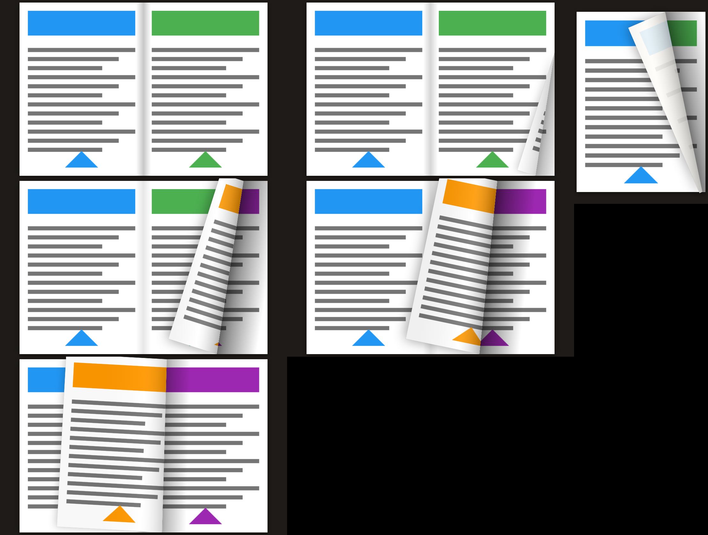

# PDF Flip Reader

แอป Flutter สำหรับอ่านไฟล์ PDF แบบหนังสือจริง (Android / iOS)



## ฟีเจอร์
- หน้าแรกเป็น **หน้าเลือกไฟล์**: กด "เลือกไฟล์ PDF จากเครื่อง" แล้วเลือกโฟลเดอร์และไฟล์จากหน้าต่างของมือถือ
  แอปจะจำรายการ "เปิดล่าสุด" พร้อมชื่อไฟล์ ชื่อโฟลเดอร์ และหน้าที่อ่านค้างไว้ เปิดครั้งหน้ากดได้ทันที
- แสดงแบบ **หน้าเดี่ยว** (ค่าเริ่มต้น) หรือ **หน้าคู่** (ปุ่มสลับมุมขวาบน แอปจำค่าที่เลือกไว้)
- **เสียงพลิกหน้ากระดาษ** เปิด/ปิดได้ มีให้เลือก 10 เสียง พร้อมปุ่มฟังตัวอย่างและปรับความดัง
  (ไอคอนโน้ตดนตรีที่หน้าแรก หรือเมนู ⋮ > เสียงพลิกหน้า…)
  เสียงทั้งหมดสังเคราะห์ขึ้นเองด้วย `tools/gen_sounds.py` จึงไม่มีปัญหาลิขสิทธิ์
- **ไถนิ้วไปทางซ้าย** = หน้าถัดไป, **ไถนิ้วไปทางขวา** = หน้าก่อนหน้า
  หน้ากระดาษจะม้วนพลิกตามนิ้วแบบเรียลไทม์ (จับมุมบนหรือล่างได้ตามตำแหน่งที่เริ่มแตะ)
  ปล่อยนิ้วก่อนถึงกลางเล่ม หน้าจะตกกลับที่เดิม
- **เคาะสองครั้ง** = หน้าต่างถามเลขหน้า พิมพ์แล้วกด Enter เพื่อไปหน้านั้น
- เคาะครั้งเดียว = ซ่อน/แสดงแถบเครื่องมือ (ซ่อนแล้วเป็นเต็มจอ เหมาะกับฉายโปรเจกเตอร์)
- เมนู ⋮ > "หน้าปกแสดงเดี่ยว" (หน้า 1 อยู่ขวาเหมือนหนังสือจริง)
- เมนู ⋮ > "พลิกหน้าจากขวาไปซ้าย" สำหรับหนังสือภาษาอาหรับ มังงะ หรือหนังสือญี่ปุ่นแนวตั้ง: สันหนังสืออยู่ขวา ปัดขวาไปหน้าถัดไป ปัดซ้ายย้อนกลับ แถบเลื่อนและลูกศรกลับด้านตาม แอปจำค่านี้แยกเป็นรายเล่ม ถ้ายังไม่เคยตั้ง จะเปิดให้อัตโนมัติเมื่อเมนูเป็นภาษาอาหรับ
- แถบเลื่อนด้านล่างสำหรับข้ามหน้าเร็วๆ
- เมนู ⋮ > "โหมดกลางคืน" เปลี่ยนหน้ากระดาษเป็นพื้นเข้ม ตัวหนังสือสีเทาอ่อน หรี่แสงลง สีภาพยังคงโทนเดิม เหมาะกับอ่านในห้องมืดหรือฉายขึ้นเพดานก่อนนอน
- เมนู ⋮ > "หมุนจอ" (หรือปุ่มหมุนที่หน้าเลือกไฟล์) หมุนทั้งแอปทีละ 90° รวมเมนูและหน้าต่างถามเลขหน้า ใช้เมื่อโปรเจกเตอร์หรือเพดานแสดงภาพตะแคงหรือกลับหัว กดซ้ำจนครบ 360° เพื่อกลับเป็นปกติ
- รองรับรีโมตพรีเซนต์ / คีย์บอร์ดบลูทูธ (ลูกศร, Page Up/Down, Space)
- หน้าจอไม่ดับระหว่างอ่าน

## การปิดแอป
- กดปุ่ม ⏻ ที่หน้าแรก หรือเมนู ⋮ > "ออกจากแอป" ขณะอ่าน
- หรือเปิดหน้าแอปที่ใช้ล่าสุดของ Android (ปุ่มสี่เหลี่ยม หรือปัดขึ้นจากขอบล่างค้างไว้) แล้วปัดหน้าต่างแอปนี้ขึ้นไป
  แบบนี้ระบบจะปิดแอปออกจากหน่วยความจำทั้งหมด
- ปุ่มย้อนกลับขณะอ่านจะกลับไปหน้าเลือกไฟล์ และแอปจะจำหน้าที่อ่านค้างไว้

## โครงสร้างโค้ด
- `lib/book_painter.dart` วาดหนังสือและเอฟเฟกต์ม้วนหน้า (คำนวณเส้นพับ เงา และด้านหลังหน้ากระดาษ)
- `lib/reader_screen.dart` หน้าจอหลัก ท่าทางนิ้ว อนิเมชัน หน้าต่างใส่เลขหน้า
- `lib/page_cache.dart` เรนเดอร์หน้า PDF เป็นรูปและแคชไว้ (แพ็กเกจ pdfx)
- `lib/library_screen.dart` หน้าเลือกไฟล์และรายการเปิดล่าสุด
- `lib/flip_sounds.dart`, `lib/sound_settings.dart` เสียงพลิกหน้าและหน้าตั้งค่าเสียง
- `lib/settings.dart` บันทึกการตั้งค่าไว้ในเครื่อง

## วิธี build APK
ต้องมี Flutter 3.41+ และ Android Studio (Android SDK)
```
flutter pub get
flutter build apk --release
```
ไฟล์ที่ได้: `build/app/outputs/flutter-apk/app-release.apk` คัดลอกไปติดตั้งในมือถือได้เลย

หรืออัปโหลดโฟลเดอร์นี้ขึ้น GitHub แล้ว GitHub Actions (`.github/workflows/build-apk.yml`)
จะ build APK ให้อัตโนมัติ ดาวน์โหลดได้ที่แท็บ Actions > Artifacts

## ฉายขึ้นโปรเจกเตอร์
ตั้งมือถือเป็นแนวนอน เปิดโหมดหน้าคู่ เคาะหนึ่งครั้งให้เต็มจอ แล้วใช้ Screen Mirroring
(Smart View / Cast / Miracast) ไปยังโปรเจกเตอร์หรือ dongle ที่เสียบอยู่กับโปรเจกเตอร์

## โฆษณา (AdMob)
- แบนเนอร์เล็กแสดงที่ด้านล่างหน้าเลือกไฟล์เท่านั้น ไม่มีโฆษณาระหว่างอ่านหรือบนจอโปรเจกเตอร์
- จำกัดระดับเนื้อหาโฆษณาเป็น G (บุคคลทั่วไป) (`lib/ads.dart`)
- ตอนนี้ใช้ **รหัสทดสอบของ Google** แสดงโฆษณาตัวอย่างและไม่มีรายได้ ก่อนขึ้น Play Store ต้องเปลี่ยนเป็นรหัสของคุณ 3 จุด:
  1. `lib/ads.dart` รหัสหน่วยโฆษณา (Ad unit ID)
  2. `android/app/src/main/AndroidManifest.xml` App ID (`com.google.android.gms.ads.APPLICATION_ID`)
  3. `ios/Runner/Info.plist` App ID (`GADApplicationIdentifier`)

## ภาษาของเมนู (23 ภาษา)
ปุ่มรูปตัวอักษร (ไอคอนแปลภาษา) ที่หน้าแรก หรือเมนู ⋮ > ภาษา… ขณะอ่าน
ค่าเริ่มต้นคือ "ตามภาษาของเครื่อง" ถ้าภาษาของเครื่องไม่อยู่ในรายการจะใช้ภาษาอังกฤษ

English, ไทย, 简体中文, 繁體中文, 日本語, 한국어, Français, Deutsch, Italiano, Español, Português,
Русский, Українська, Polski, Nederlands, Türkçe, العربية, हिन्दी, বাংলা, Bahasa Indonesia,
Bahasa Melayu, Tiếng Việt, Filipino

คำแปลทั้งหมดอยู่ใน `tools/translations.py` แก้แล้วรัน `python3 tools/translations.py` เพื่อสร้าง `lib/strings.g.dart` ใหม่
